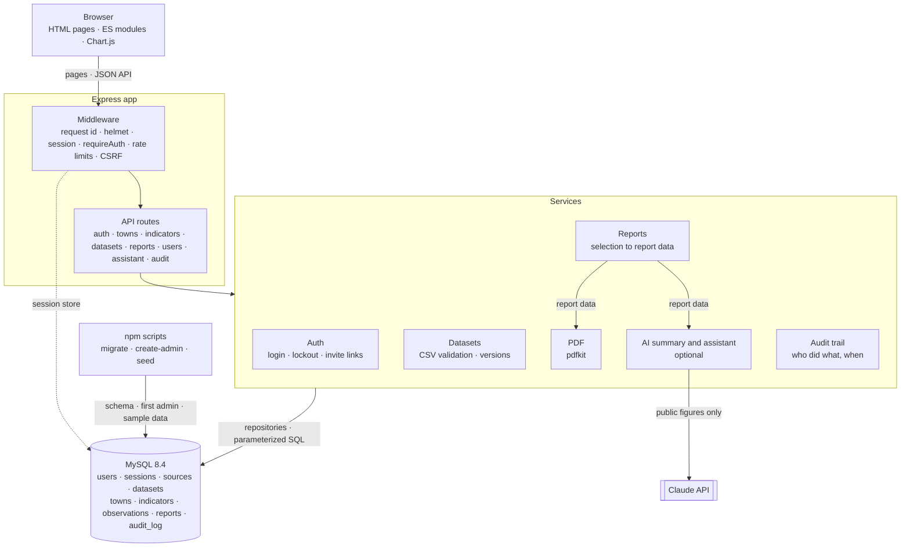

# System architecture

How the CT Civic Data Explorer fits together. Solid arrows are requests and data flow; the dotted arrow is the session store.

- Every report starts as a **selection** (towns, indicators, and a layout of text, chart and table blocks). The Reports service turns it into one report-data object, which the browser preview, the PDF and the AI summary all use, so they always match.
- Town selection has no count limit. `report-charts.js` includes every requested numeric indicator in the output: grouped bars and lines use separate charts per unit and at most six series per chart, while bars use one chart per indicator. A chart layout block may expand into multiple titled chart blocks. Source records are preserved without aggregation or truncation.
- Rates such as poverty rate are computed on the server from stored values.
- The AI summary and the data assistant are optional; reports build and export without them. The assistant reads data only through the same services as the signed-in user.
- Routes record sign-ins and changes to people, datasets and reports in the audit trail after the change succeeds; a failure to record never fails the request.
- Running it for real users is covered in [deployment.md](deployment.md).
